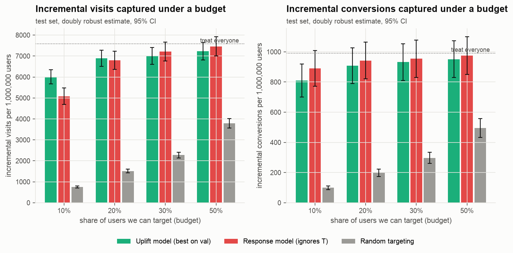
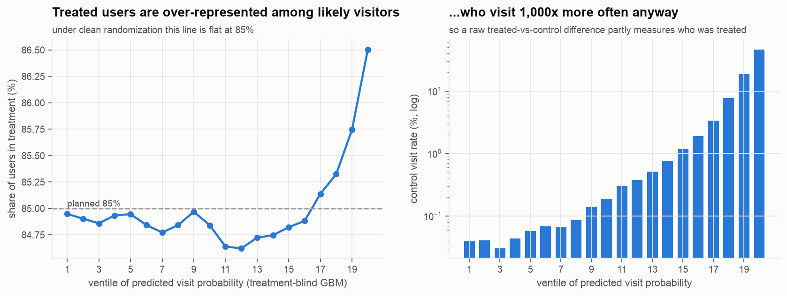

# incrementality-lab

Criteo published a randomized ad experiment with 14 million users (Criteo Uplift v2.1). I used it to
answer the questions I'd want settled before trusting a lift number. Is the randomization clean?
What is the actual average effect? How early could the test have been stopped? And if budget is
limited, who should see the ads?

The short answers:

- Ads raise site visits by **0.75 pp (+18.6%, 95% CI 17.8–19.3%)**. The raw treated-minus-control
  difference says 1.03 pp (+27%). The gap is about 19 standard errors, and it comes from how the
  public file was put together (more below).
- With budget for 10% of users, picking them by X-learner uplift gets **79% of all incremental
  visits**: 6,012 per million users, against 5,082 for a "likely to visit" model and 758 at random.
  Past a 20% budget the plain response model is as good.
- Peeking at a t-test 100 times called a winner in 38% of A/A tests. An mSPRT stayed at 3%, and on
  the real effect it reached a decision after a median of 31k users.



| | Naive / baseline | This analysis |
|---|---|---|
| Visit effect | 1.034 pp [1.006, 1.063] | 0.750 pp [0.725, 0.776] (AIPW) |
| Visit relative lift | 27.1% | 18.6% [17.8, 19.3] |
| Conversion effect | 0.115 pp [0.108, 0.122] | 0.099 pp [0.093, 0.106] (AIPW) |
| Conversion relative lift | 59.4% | 48.4% [43.7, 53.1] |
| Effect of seeing an ad (visits) | 37.9 pp exposed vs not | 28.7 pp [27.9, 29.5] (IV) |
| Variance of the visit ATE | difference in means | -31% with CUPAC (= 1.44x users) |
| A/A false positives, 100 peeks | 37.9% (t-test) | 3.0% (mSPRT) |
| Users to call the visit effect | 21,145 (fixed horizon, effect known) | 30,846 median (mSPRT) |
| Test-set Qini, visits | response 0.085, random -0.001 | X-learner 0.093 [0.088, 0.098] |
| Extra visits per 1M users, 10% budget | random 758, response 5,082 | 6,012 [5,672, 6,352] (79% of all) |
| Extra visits per 1M users, 20% budget | random 1,516, response 6,797 | 6,892 [6,500, 7,284] (91% of all) |
| Extra visits per 1M users, 50% budget | random 3,789, response 7,461 | 7,231 [6,814, 7,648] (95% of all) |

`make analysis` writes this table to `report/results/summary.md` from the JSON outputs. The full
write-up, with every figure, is in `report/` ([online version](https://egkiastas.github.io/incrementality-lab/)),
and the reasoning behind the main choices is in [docs/design.md](docs/design.md).

## Running it

```bash
uv sync                 # Python 3.12 environment from uv.lock
make data               # download ~311 MB, check checksums, convert to Parquet
make analysis           # all steps on the full data, about 45 min on a 16 GB M4
make report             # build report/index.html
make test               # unit and recovery tests, ~3 min
```

Every script also takes `--fixture`, which runs it on a 40k-row synthetic file in a few seconds,
e.g. `uv run python analysis/05_uplift_models.py --fixture`. The tests use the same fixture.

## What surprised me

**The randomization passes the usual checks and still isn't clean.** The sample-ratio test gives
p = 0.999 and every standardized mean difference is under 0.05. At 14M rows that threshold is
meaningless, though. All 12 features differ between the arms by 7 to 65 standard errors, and a
classifier separates the arms with AUC 0.507 [0.506, 0.509]. The treated share is 85.00001%, which
is closer to 85% than independent assignment would get about 999 times in 1,000.



Sorting users by predicted visit probability explained it. The treated share sits around 84.8% for
most users and rises to 86.5% in the top ventile, which is where people visit regardless. The
Criteo paper says sub-tests were re-sampled to 85% treated and negatives were down-sampled, and that
would produce this pattern. Adjusting for the features (AIPW, CUPED, CUPAC, post-stratification)
moves the estimate down by 19–27 standard errors. On fake splits of control users the same
adjustment is unbiased, so it isn't the adjustment creating the gap.

**Breaking ties wasn't optional.** The CSV is sorted by treatment, and LightGBM gives many users the
same score. A stable sort leaked file order into the decile tables, and one decile ended up with no
control users at all. Ties are now broken at random before any ranking.

**The things that didn't work:**

- No "do not disturb" group. Users predicted to be hurt by ads (5% of the test set) show a positive
  effect, +0.43 pp [0.07, 0.79]. What does hold is that the bottom half by predicted uplift accounts
  for only about 5% of incremental visits.
- Conversions are too sparse (0.19% in control) to target. No uplift model beat the response model
  on conversions, and targeting conversions with the visit model was no better.
- The T-learner is clearly worse than the X-, S- and DR-learners, which are close to each other. Its
  control model only sees 15% of the data.
- Exposure-based comparisons are badly confounded. Only 3.6% of treated users ever saw an ad, and
  those users differ from the rest by up to 1.47 SD on features. They'd have visited at 12.8%
  without any ad, against 3.8% overall, so exposed vs unexposed overstates the effect 1.3x. The IV
  estimate is the fairer number, though it still assumes no effect of assignment without exposure.

## Limitations

- The absolute numbers describe this re-sampled file, not Criteo's live campaigns. What should
  transfer is the method and the relative conclusions.
- The adjusted estimators don't fully agree (0.63–0.75 pp for visits). Each one corrects a different
  part of the imbalance, and I report AIPW with an estimated propensity as the headline.
- The file has no sub-test IDs, so there is no within-test analysis and no way to undo the
  re-sampling directly.
- Models train on 4M-user subsamples (0.5M for the causal forest) to fit in 16 GB. Every estimate
  and evaluation uses all rows of its split.
- The sequential replays reorder users at random. The file has no timestamps, so real arrival-order
  effects such as novelty aren't captured.

## Layout

- `incrementality/`: estimators as plain functions on NumPy arrays (stats, adjustment, sequential, uplift)
- `analysis/`: numbered scripts, each writing one JSON file to `report/results/` plus its figures
- `report/`: the write-up (`report.py`, a jupytext notebook) and its build script
- `tests/`: estimator tests against known answers, Qini/AUUC checked for exact equality with
  scikit-uplift, and a smoke run of every script on the fixture

The data is the [Criteo Uplift Prediction Dataset v2.1](https://ailab.criteo.com/criteo-uplift-prediction-dataset/)
(Diemert et al., 2021, CC BY-NC-SA 4.0). It is downloaded by `make data` and never committed. The
code is MIT licensed.
